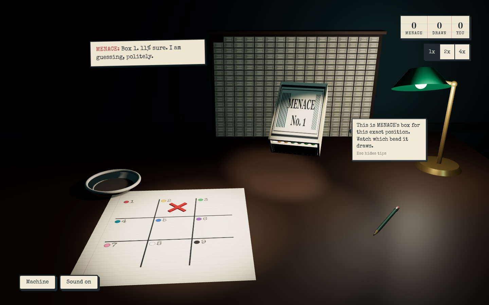

# MENACE

Play noughts and crosses against MENACE, Donald Michie's 1961 learning machine, and watch it learn you.

**Play it: [menace-game.vercel.app](https://menace-game.vercel.app)**



In 1961 Michie built a player out of 304 matchboxes and coloured beads. Each box stands for a position MENACE can face. To move, it shakes the box for the current position and draws a bead; the bead's colour is the square it plays. After the game, every box it used gets beads added if it won or drew, and loses the drawn bead if it lost. Over a few dozen games, the good moves crowd out the bad ones. It is reinforcement learning with no computer.

This game puts that machine in a 3D study at night. On MENACE's turn the matching box slides out of the cabinet, rattles, and drops a bead on its square. After each game a ledger walks through every box it used and shows the beads going in or out.

## What you can do

- **Play** with the mouse, touch, or keys 1 to 9 (1 is top-left).
- **Watch it learn:** the post-game ledger, a learning curve, and a box inspector for any of the 304 boxes.
- **Train** it against a random player, a perfect player, or a copy of itself, 10 to 1,000 games at a time.
- **Tinker** with the starting beads and rewards, or switch to an alternative rule set that makes boxes as it needs them.
- **Goals:** your running record, the moment it goes 10 games unbeaten against you, and a challenge to beat a fresh MENACE 3 times before it gets there.
- **Save and share** its brain: progress saves in the browser, and brains export and import as JSON.

## Faithful to 1961 by default

| Rule | Value |
|---|---|
| Boxes | 304: every position MENACE faces on its moves 1 to 4, merged by symmetry |
| Starting beads per legal move | 4, 3, 2, 1 on MENACE's moves 1, 2, 3, 4 |
| Rewards | win +3, draw +1, loss -1 |
| Empty box | MENACE resigns |
| First player | MENACE plays X and moves first |

The 304 count is the anchor test of the engine.

## Accessibility

Screen readers hear every move with the board read out, the result, and each ledger box. Every bead colour also carries its square number. Reduced-motion settings shorten the animations and remove the shaking, and weaker devices drop to a lighter render. Lighthouse accessibility: 100.

## Built with

React, TypeScript, Vite, React Three Fiber and drei (three.js), and Zustand. Static site, no backend. The learning engine is a TypeScript port of my Python [menace-tictactoe](https://github.com/Morgan971-pixel/menace-tictactoe), with one bug fixed on the way: move translation for 90 and 270 degree board rotations used the inverse permutation, so MENACE sometimes picked an occupied square.

```
src/engine   rules, symmetry, MENACE, opponents, trainer (no React)
src/state    game store, persistence, learning curve, inspector
src/scene    the 3D study
src/ui       panels and overlays
src/audio    sound cues and Web Audio placeholders
```

## Run it

```
pnpm install
pnpm dev        # http://localhost:5173
pnpm test       # 420 tests
pnpm build
```

Optional: `node scripts/make-sfx.mjs` with `ELEVENLABS_API_KEY` in `.env` generates recorded sound effects into `public/sfx/`. Without them the game uses synthesized sounds.
